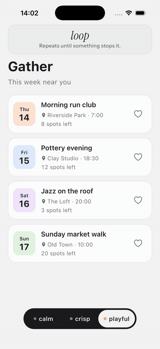
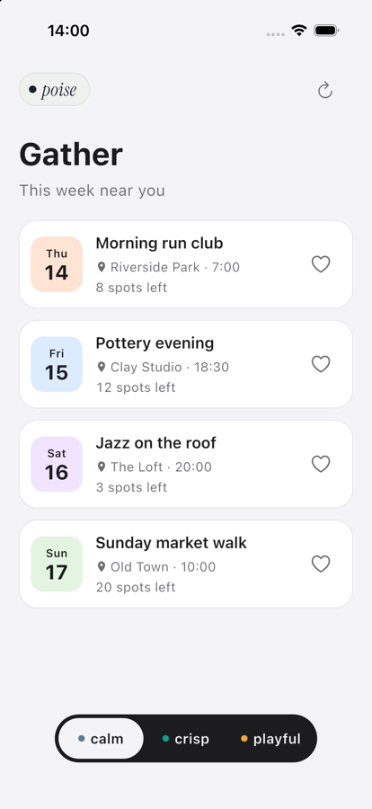
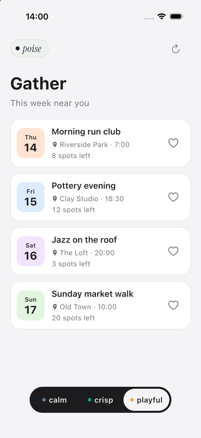
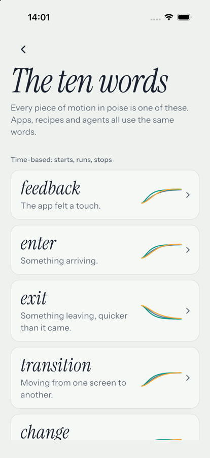
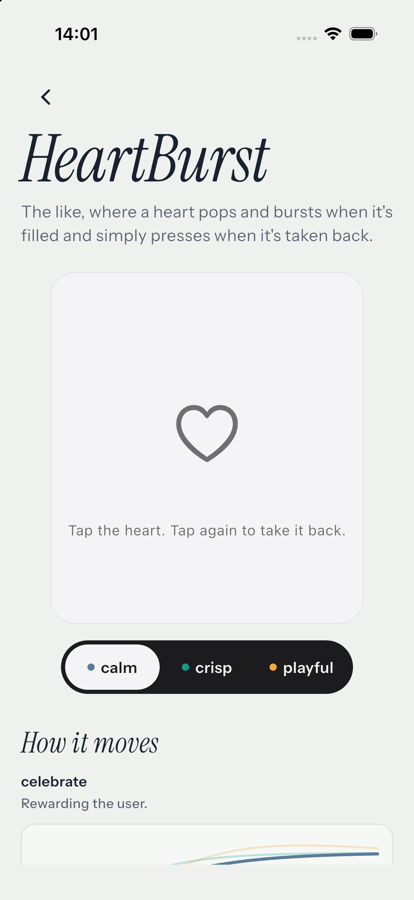

# poise

Motion for Flutter apps, built so your AI agent already knows it.

<p align="center">
  
</p>

Every Flutter app I build ends up with me explaining the same things to my agent: put a spring on this press, bring the list in one item at a time, and keep it smooth on cheap phones. The agent gets close, but close in motion often looks like a bug, so I fix it by hand. Then the next project comes along and I explain it all over again.

poise is where those fixes live once. Motion is one of ten words. A personality decides what each word feels like. Recipes are finished pieces built on the words that you copy into your app and own, the way shadcn/ui works on the web. And a skill teaches your agent all of it, so "use the settled reveal" means the same thing every time.

## What's here

| | |
|---|---|
| [`packages/poise`](packages/poise) | The core package: the ten words, `Move` and `Fade`, the personalities, and `context.motion`. |
| [`registry`](registry) | Eleven recipes, one for every word, each with tests, a manifest and a README. You copy them in. |
| [`skill/poise`](skill/poise) | What your agent reads. Short, with one reference per recipe generated from the registry. |
| [`gallery`](gallery) | Gather, a small app built entirely from the recipes, with a dial that switches its personality live, a page per recipe and word, and a tour that plays itself for recordings. |
| [`docs`](docs) | [The vocabulary](docs/motion-vocabulary.md) and [the feel layer](docs/feel.md). |

## Quick start

**1. Add poise.** It isn't on pub.dev yet, so point at the repository:

```yaml
dependencies:
  poise:
    git:
      url: https://github.com/jeremyessien/poise.git
      path: packages/poise
      ref: v0.1.0
```

**2. Choose a personality** above your app. Everything below reads it.

```dart
import 'package:poise/poise.dart';

PoiseScope(
  motion: PoiseMotion.crisp,
  child: const App(),
)
```

**3. Copy a recipe.** Take its folder from `registry/lib/` into `lib/poise/` in your app, with anything its `recipe.yaml` lists under `needs`, and import it by your own package name.

```dart
import 'package:my_app/poise/reveal/reveal.dart';

Reveal(
  visible: justSaved,
  child: const SavedToast(),
)
```

**4. Install the skill.** Copy `skill/poise` to wherever your agent loads skills from, such as `.claude/skills/poise/` in your app. From then on it knows the words, the personalities, the rules, and every recipe.

Anything you write yourself reads the word it needs instead of picking numbers:

```dart
final enter = context.motion.enter;
AnimatedContainer(duration: enter.duration, curve: enter.curve, child: card);
```

## The ten words

| Word | Means | Recipe |
|---|---|---|
| `feedback` | The app felt a touch. The quickest motion there is. | `Pressable` |
| `enter` | Something arriving. | `Reveal`, `StaggeredColumn` |
| `exit` | Something leaving. Quicker than `enter`, never bounces. | `Reveal`, `PoiseRoute` |
| `transition` | Moving from one screen to another. | `PoiseRoute` |
| `change` | Something updating where it already is. | `TextSwap`, `CountUp` |
| `attention` | Look here, usually because something went wrong. | `Shake` |
| `celebrate` | Rewarding the user. | `HeartBurst`, `SuccessCheck` |
| `follow` | Tracks a finger, then settles from the speed it let go at. | `PoiseSheet` |
| `loop` | Repeats until something stops it. | `Shimmer` |
| `stagger` | The gap between items in a group. | `StaggeredColumn` |

Three personalities ship. `calm` is settled and quiet, for products where trust and focus matter more than delight. `crisp` is quick and exact, for banking, productivity and tools. `playful` is springy and alive, for kids' apps, games and social. Adjust one word with `copyWith` and keep the rest.

When the phone asks for less motion, `context.motion` is already `reduced`: timed words become short fades, nothing travels, loops hold still. You never check for it.

## Recipes

Every recipe follows the personality, handles reduce motion, mirrors in right-to-left languages, turns around smoothly if interrupted, and says what it needs to say to screen readers.

| Recipe | What it's for |
|---|---|
| [`Pressable`](registry/lib/pressable) | Makes any widget respond to a press, and dims instead of shrinking when the phone asks for less motion. |
| [`Reveal`](registry/lib/reveal) | Brings a widget in and takes it away on springs that turn around smoothly if you change your mind halfway. |
| [`StaggeredColumn`](registry/lib/staggered_column) | A column whose children arrive one after another, spaced by the personality's stagger gap. |
| [`PoiseRoute`](registry/lib/poise_route) | A page route that slides between screens in your personality, and keeps the swipe back on iOS. |
| [`PoiseSheet`](registry/lib/poise_sheet) | A bottom sheet you can drag and throw, which settles from the speed your finger let go at. |
| [`TextSwap`](registry/lib/text_swap) | Text that changes where it stands, rolling the new words in and announcing them to screen readers. |
| [`CountUp`](registry/lib/count_up) | A number that counts to its new value, so a balance or a score visibly climbs instead of jumping. |
| [`Shake`](registry/lib/shake) | The "no" wobble for a wrong password or a code that didn't work, which flashes instead when motion is reduced. |
| [`HeartBurst`](registry/lib/heart_burst) | The like, where a heart pops and bursts when it's filled and simply presses when it's taken back. |
| [`SuccessCheck`](registry/lib/success_check) | A tick that draws itself inside a circle that pops in, for the moment something has worked. |
| [`Shimmer`](registry/lib/shimmer) | Loading placeholders that breathe or shimmer in your personality, and hold still when motion is reduced. |

<p align="center">
  
  
  
  
</p>

## The gallery

```
cd gallery
flutter run -d <device>
```

Gather is a small events app made only from the recipes. Press a card, save an event, drag the sheet, watch the list come in, then turn the dial from calm to crisp to playful and the whole screen changes feel. Same screen, same code. The menu behind the poise mark has a page for every recipe and every word, switches for slow motion, reduce motion and showing touches, and a tour that walks the whole app by itself, captioned, so a recording is one tap.

It's early. The ten words won't change. The values behind them and the recipes' details still might, as I keep tuning them on real phones.

## Licence

[MIT](LICENSE).
